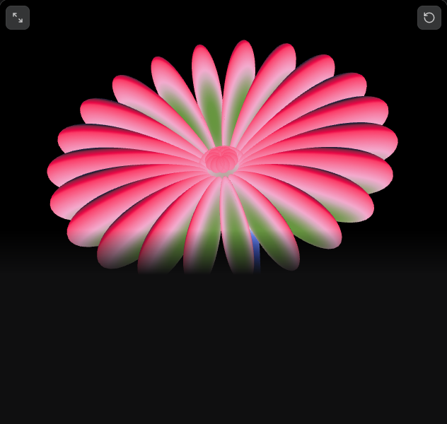

# Balloon Zinnia

A WebGL zinnia for the registry, matching the live base preset.

The flower is already built. Each petal is an egg-shaped ellipsoid, hinged around a throat, drawn from a data texture. Colour is one 13-stop ramp sampled along a single axis through the scene. One 14 second clock runs the sway, eight breaths, eight colour flows and six band pulses. The pointer turns the head, swells nearby petals, and a tap bobs it on a damped spring.

Proof is the pinned module at `reference/balloon-zinnia/component.mjs` (sha256 `bd5f6e08…`), shader strings copied out of it, and a screenshot of our default preset against the live canvas.

## What it looks like

Live canvas, 632 by 600, base preset, black ground. Pink petals, a green band through the middle, a small throat, a short blue stem under the head.

Mechanism, one sentence: instanced ellipsoids and a tube stem are projected by the same perspective function, then both fragment shaders paint `textureLod` of a 512-wide palette using `dot(P - head, bandAxis) + phase`.

## Files

| Path | Role |
| --- | --- |
| `reference/balloon-zinnia/component.mjs` | Pinned source. Not installed. |
| `src/registry/balloon-zinnia/shaders.ts` | Vertex and fragment strings, same text as the module. |
| `src/registry/balloon-zinnia/engine.ts` | Stem curve, palette, draw loop, pointer springs. Same numbers. |
| `src/registry/balloon-zinnia/index.tsx` | React wrapper. Props are the editor controls. |
| `src/components/demos/balloon-zinnia.tsx` | Full-frame demo, no extra copy. |
| `src/components/demos/index.tsx` | Demo map entry. |
| `src/lib/registry.ts` | Registry item, Animations, no dependencies. |
| `src/lib/registry-groups.ts` | Group "3D and WebGL scenes". |
| `src/lib/component-meta.ts` | API, the few controls worth exposing, nuance. |
| `tests/balloon-zinnia.test.mjs` | Shader text and the constants that set the silhouette, compared to the pin. |

## Decisions

Defaults are the editor values the page is showing, not the unused numeric fallbacks inside the module.

- Background `#000000`. Thirteen colours, widths 9.4, 6.2, 3.1, 14.8, 2.3, 4.7, 2.3, 6.3, 10.2, 12.5, 4.7, 0.8, 22.7.
- 22 petals, length 200, width 100, puff 134, bands 5, grain 0, scale 100.
- Stem on, curve 100, thickness 100.
- Entrance off. Response and motion all at 5.
- Advanced: lean 48, band axis 48, lens 12, cup 25, twist 0, inner capsules 10, turn 29, nod 0, breathe angle 35, loop 14, pulse depth 36, phase 60, bloom 0.9, follow ease 0.3.

The wrapper fills its parent. It keeps the source aspect of 720/1280 only when the parent does not set a height, so the detail-page preview can be a wide stage the way the live editor is.

Reduced motion freezes the loop and skips the entrance, same as the source. Offscreen and hidden tabs stop the frame loop.

No Three.js. WebGL2 only. If the context is missing the canvas hides and the background colour remains.

Public copy does not name the source site.

## Left out

No studio panel for all 30 knobs. The props exist. The detail page documents the ones that change the picture: colours, petal count, puff, bands, scale, motion, response.

No pixel diff against the live canvas. The live frame is mid-loop and the preview box is 632 by 600. The test checks shader source and the constants. After it is in the app, a paused frame at t = 0 gets a screenshot next to `source-canvas.png`. Grain is 0, so the only noise is the 1/255 dither.

The adaptive quality ladder (LOD drop when a frame runs long) is kept. It does not change the picture on a fast machine.
