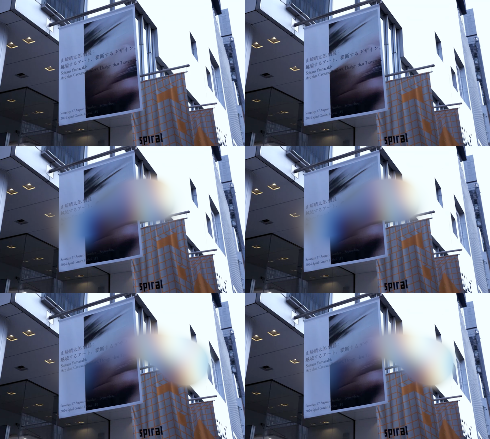

# Blur Trail Video: seitaroyamazaki.com hover effect, 1:1

**Problem.** The seitaroyamazaki.com hero blurs and colour-splits the video wherever the cursor has just been, and the blur fades out behind it. You want that effect as a registry component.
**Result.** `blur-trail-video`: a typed React component. It is a WebGL2 port of the site's three r181 WebGPU/TSL pipeline, not an iframe.
**Proof.** Same pointer path, same video frame, rAF pumped frame by frame on both pages. RMSE against the live site is 0.0053 (about 1.4/255) at DPR 1 and DPR 2.

## How the source works (read from the bundle, pinned in `reference/blur-trail-video/`)

```
pointer (eased 0.1/frame) ──► mask ping-pong (CSS px, float32)
                               m = moving ? smoothstep(0.2, 0, d) : 0  +  prev × 0.92
video ─► cover plane ─► rgbShift(0.03, 45°) ─► gaussianBlur(dir 4, σ 16, 35 taps)
                    └────────────────────────────── mix(scene, blur, clamp(m)) ─► sRGB
```

- "Moving" means the eased follower is more than 3px behind the pointer on either axis. The brush only paints while that is true.
- The brush radius is 0.2 of the short side, after aspect correction.
- The blur uses offsets in drawing-buffer pixels. At DPR 2 the blur radius is half as wide in CSS pixels. The port does the same.

## Evidence: source (left) vs port (right), video frozen at 8.0s, 1440×860

Rows: rest, mid-path, 15 frames after the pointer stops.



| capture | DPR 1 RMSE | DPR 2 RMSE |
| --- | --- | --- |
| rest | 0.0058 | 0.0058 |
| path | 0.0053 | 0.0053 |
| decay | 0.0052 | 0.0052 |

The residual is edge aliasing in the base video only: `evidence/resid-path-x8.png`, amplified 8×.

### Two non-obvious findings the diff forced

1. **Video tone.** The site samples the video as a WebGPU external texture. Chrome's colour conversion there lifts the mid-tones (136 becomes 146). Uploading as RGBA8 and decoding with exponent 1.95 matches within ±2 levels across the whole range. A plain sRGB decode was off by 0.03 RMSE.
2. **Shift direction.** three's WebGPU uv runs y-down for render targets, so the site's 45° offset points down-right on screen. The port converts the angle so the `shiftAngle` prop still reads 45 like the source.

## Files

| file | change |
| --- | --- |
| `src/registry/blur-trail-video.tsx` | new. Engine from `engine.js`, typed, root-scoped listeners, cleans up on unmount |
| `src/components/demos/blur-trail-video.tsx`, `demos/index.tsx` | demo plus registration |
| `src/components/previews/blur-trail-video.tsx`, `previews/index.tsx` | fullscreen preview |
| `src/lib/registry.ts`, `registry-groups.ts`, `component-meta.ts`, `assets.ts` | entry, group "3D and WebGL scenes", props docs, Blob asset |
| `reference/blur-trail-video/` | already pinned: page HTML, CSS, effect and pointer excerpts |

Props (source values as defaults): `src`, `decay 0.92`, `radius 0.2`, `smoothing 0.1`, `shiftAmount 0.03`, `shiftAngle 45`, `blurSigma 16`, `blurStep 4`, `className`, `children` (overlay content above the canvas).

## Decisions for you

1. **Default video.** I recommend uploading the site's `bg.mp4` (3.9 MB, 1280×720, the artist's footage) to Blob as `blur-trail-video/bg.mp4`, so the demo is the 1:1 reference. The alternative is a neutral clip of our own, which makes the demo no longer a match to the source.
2. **Small screens.** Below 768px the site swaps the canvas for a plain video with no effect. I recommend keeping the effect at all sizes, because a component has no viewport and touch drags paint the trail too. The alternative is to match the swap with a container query.

## Deliberate omissions and limits

- The site's logo, menu, Instagram button and Awwwards badge are page chrome, not the effect. Use `children` for overlay content.
- The source shows no effect in browsers without WebGPU. The port uses WebGL2, so the effect runs everywhere.
- The γ 1.95 constant was measured against Chrome on macOS. Other browsers may convert this video's colours differently.
- The effect is frame-rate dependent (0.92 decay and 0.1 easing per frame), as in the source. On a 120Hz display the trail fades twice as fast, exactly as it does on the site.
