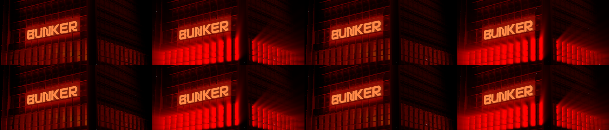
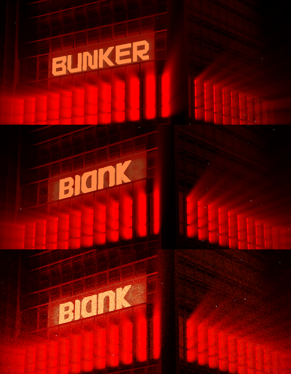

# Bunker Scene: basement.studio lab 32, with the BLANK sign

**Problem.** The lab experiment is a red-lit bunker facade with a glowing "BUNKER" sign. A hidden sun flickers on and throws god rays through the windows. You want it as a component with the new BLANK wordmark as the sign.
**Result.** `bunker-scene`: a typed React component on vanilla three, postprocessing and gsap. All three are already in the repo, so no new packages and no react-three-fiber. The sign is the BLANK mark (`blank-rand.svg` from the agency repo), extruded with its counters cut out.
**Proof.** With the source's own letters loaded (`?original`), both pages ran on the same frozen clock with the same particle positions and the noise off. RMSE is 0.009 to 0.011 across the whole flicker.

## How the source works (pinned in `reference/bunker-scene/`)

- A fov 10 camera on a fixed pose orbits on a 40s ellipse. The cursor takes over and eases with power2.out over 0.49s, and the orbit resumes 2.5s after the last move.
- A hidden red box (the "sun") sits behind the facade. A gsap timeline turns it on at 2.5s, then off, on, off, on in 0.05s and 0.2s steps.
- That box is the light source for GodRays (100 samples, density 0.9, decay 0.92, weight 0.4, exposure 0.4, Kawase blur), blended with screen.
- 1000 additive points drift on 2D simplex noise. A colour-dodge film noise at 0.75 sits on top.
- The god rays follow postprocessing 6.36, the version the source shipped. In 6.36 the light is drawn alone at half resolution and masked against scene depth. 6.37 and later change the shafts, so the port carries that version's effect as a small class.

## Evidence

Flicker, source (top) vs port with the source letters (bottom): sun off (f060), on (f152), off (f155), lit (f180).

| frame | f060 | f152 | f155 | f158 | f165 | f180 | settled |
| --- | --- | --- | --- | --- | --- | --- | --- |
| RMSE | 0.0093 | 0.0107 | 0.0095 | 0.0106 | 0.0092 | 0.0105 | 0.0113 |

Method: `verify/clock.js` steps both pages frame by frame from their first scene frame. The source's particle positions are read out and injected into the port, particle drift is held at 0 on both, and film noise is off on both. `verify/capture.sh noise` runs the same capture with noise on.

The BLANK sign. Rows are source (noise off), BLANK (noise off) and BLANK as shipped (noise on):

## The sign swap

- The six letter meshes (B, U, N, K, E, R on material LIGHT) are removed. The BLANK mark replaces them with the same node transform and the same LIGHT material, and it is extruded over the letters' own depth.
- **Spacing.** The gaps between letters go from 22 to 44 SVG units (`MARK_GAP`), which copies BUNKER's gap-to-height ratio of 0.18.
- **Size.** The mark is scaled so its lit face area equals BUNKER's: 122,202 units², summed from the letter faces in bunker.glb (`SIGN_FACE_AREA`). It ends up 215 local units tall against BUNKER's 189, centred on the same box. The letter faces measure 255, 135, 70 in both renders. Measured over the sign region:

| sign | lit letter pixels | mean luminance |
| --- | --- | --- |
| BUNKER (source) | 19,950 | 67.0 |
| BLANK, height fit (first pass) | 15,155 | 61.6 |
| BLANK, area fit (shipped) | 19,035 | 66.5 |
- **Shipped model.** `bunker-blank.glb` (952 KB) is the source model without the letter meshes. It is not Draco compressed, so the component fetches no external decoder.
- **Baked glow.** The facade texture bakes a BUNKER glow into the panel behind the sign. With noise off, no letter shapes show around BLANK. The glow is diffuse and reads as the same lit panel the source has.

## Decisions

1. **Sign size and spacing.** The sign uses BUNKER's letter spacing and matches its lit area, so it is about as bright as BUNKER (66.5 vs 67.0 mean luminance). The first pass fitted it to BUNKER's height and read dimmer (61.6).
2. **Assets.** I plan to upload `bunker-blank.glb` to Blob as `bunker-scene/bunker.glb`. The source's BUNKER model stays in `reference/` only, for the comparison.

## Props

`modelSrc`, `dracoDecoderPath`, `sign` ("blank" | "model"), `sunColor` (#ff0000), `godRays` (partial of the source settings), `noiseOpacity` (0.75), `particleCount` (1000), `particleSize` (25), `particleSpeed` (0.1), `particleDisplacement` (0.5), `rotationStrength` (1), `className`. It renders only while on screen. Under reduced motion the sun is lit from the start and the camera holds still.

## Omissions and limits

- The lab's Leva panel is chrome.
- The cursor is normalised to the component box, where the source uses the window.
- The noise-on frames are random per frame and were not diffed.
