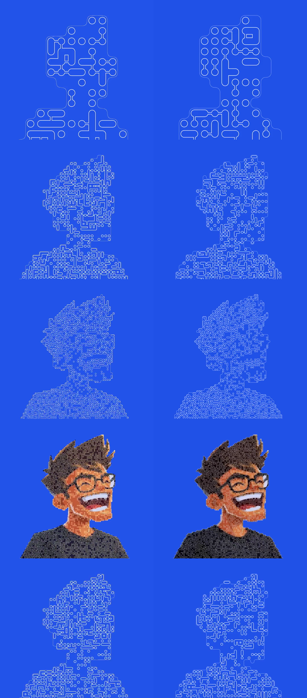
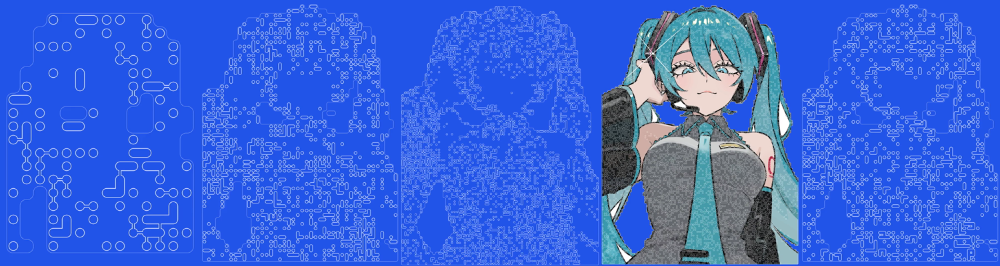

# Cell Portrait

## Goal

1. **Problem.** "Dhruv - computational experiments by opus 5.5.mp4" shows a portrait built from joined circles. The grid shrinks, the image colours in, and the loop runs backwards. It needs to become a GSAP registry component.
2. **Result.** `cell-portrait` renders any portrait the same way, with the Miku illustration you sent as the demo image.
3. **Proof.** A frame-captured preview matches the video's measured timing, geometry and statistics. Numbers and recordings are below.

Live preview (isolated, not wired into the app):
`https://cell-portrait.compronents.localhost:1355/?img=miku` and `?img=dhruv`

Direction discovery was skipped because the source is supplied and exact. Every value in the preview comes from the video, not from taste.

## What the video does (measured, 180 frames at 30fps, 6.0s loop)

| Part | Measured value |
| --- | --- |
| Canvas | 540 CSS px square at 2x. A grid line crosses the centre (anchor fitted to within 0.5px across 17 cell sizes). |
| Background | `#2253E9`. Strokes are white. |
| Cell mask | A cell belongs to the silhouette when more than 50% of it is opaque. This reproduces all 196 coarse cells in frame 1. |
| Circle | radius = cell / 3 |
| Joins | 42% of neighbouring pairs join. A join is a full capsule (half-width cell/3) or a thin bridge (half-width cell/12). The full share rises from 0.45 at 36px cells to 0.65 at 7px. Joins don't depend on colour similarity (checked). |
| Presence | Depends on brightness. P = 0.9 - 0.8 x luma, and zero above luma 0.7. Teeth and glare stay empty, which is why the face reads even in outline. |
| Stroke | min(cell / 12, 1.4px). Clusters are outlined as one shape: rounded outside, square-cornered holes. |
| Silhouette | Staircase along the cell edges, corners rounded at 0.45 x cell, drawn as a 1 device-pixel line at 85% opacity. |
| Reshuffle | New random layout every 133ms and on every change of cell size. |
| Colour phase | The image clipped to the staircase. Each shape is filled with its cell's average colour and keeps its white outline. The fade-in is a plain crossfade over 0.16s. |

Timeline (cell sizes tweened on a log scale, all `sine.inOut`):

| Tween | Start | Duration |
| --- | --- | --- |
| Cells 36 to 7px | 0 | 1.91s |
| Cells 7 to 5px | 2.323s | 0.197s |
| Colour in | 2.373s | 0.162s |
| Colour out | 3.909s | 0.166s |
| Cells 5 to 7px | 3.98s | 0.1s |
| Cells 7 to 36px | 4.39s | 1.61s |

## Visual explanation

```
 image ──> sampler ──> grid per cell size ──> layout (seed = 133ms tick) ──> renderer ──> canvas
           key bg,      mask, mean colour,      circles, full / thin          outline layer
           cell means   presence odds,          joins                         + colour layer (fades)
                        staircase path                                              ^
 GSAP timeline ── cell size (log), colour ──────────────────────────────────────────┘
```

### Evidence: original beside the preview

Left is the original video. Right is the preview, run on a portrait rebuilt from the video's colour frames (the original PNG isn't available). Frames at 0.0, 1.2, 2.0, 3.3 and 5.0s:



Full 6s loop side by side: [evidence/video-vs-preview.mp4](evidence/video-vs-preview.mp4)

| Check (same detector run on both) | Video | Preview |
| --- | --- | --- |
| Rounded cell size, per frame | reference | 166/180 exact, the other 14 off by 1px |
| Colour fade, squared error over 13 sampled frames | reference | 0.045 |
| Grid phase at 5px cells | (3, 4) | (3, 4) |
| Stroke width at 36 / 12 / 8 / 7px cells (video px) | 2.78 / 2.07 / 1.33 / 1.12 | 2.75 / 2.00 / 1.50 / 1.25 |
| Bridge outer width at 36 / 12 / 7px cells | 14 / 6 / 4 | 15 / 6-7 / 3-4 |
| Full / thin joins at 7px, about 10k pairs | 0.291 / 0.146 | 0.281 / 0.147 |
| Circles present at 7px | 0.76 | 0.74 |
| Colour-phase ring brightness (luma, integrated) | 194 | 176 |

### Evidence: your image



Full loop: [evidence/miku-loop.mp4](evidence/miku-loop.mp4)

The Miku PNG is opaque on white, so the component keys the background. It removes border-coloured regions that touch the edge, plus enclosed pockets larger than 0.4% of the image (the gaps between hair strands, arm and neck). Eye whites and highlights are smaller, so they stay. Transparent PNGs skip keying and use their own alpha.

## Files

Before: nothing.

After:

| File | Responsibility |
| --- | --- |
| `src/registry/cell-portrait.tsx` | The component. Sampler, keying, staircase tracer, layout, renderer, GSAP timeline. One file, installs to `components/ui/cell-portrait.tsx`. |
| `src/components/demos/cell-portrait.tsx` | Demo on the Miku image at 3:4. |
| `src/components/previews/cell-portrait.tsx` | Fullscreen preview. |
| `src/components/studios/cell-portrait.tsx` | Studio: background and stroke colours (`StudioColor`), speed and start/end cell size (`SliderComfortable`). |
| `src/components/{demos,previews,studios}/index.tsx` | One import and one map entry each. |
| `src/lib/registry.ts` | Entry: Animations, dependency `gsap`. |
| `src/lib/component-meta.ts` | API, nuance, editable controls, assets. |
| `src/lib/registry-groups.ts` | Added to "Creative studio and experimental". |
| `src/lib/assets.ts` | `cell-portrait-miku` at `cell-portrait/miku.png`. |
| `reference/cell-portrait/source.json` | Video filename, sha256, size, frame count. Text only. No video binary in git. |
| `reference/cell-portrait/measurements.json` | Per-frame cell sizes, colour samples, presence bins, join rates, stroke widths, grid anchor. |
| `tests/cell-portrait.test.mjs` | Focused tests against `measurements.json` (below). Added to the `test` script in `package.json`. |

## Decision-bearing code

**One outline per cluster.** Every circle and half-bridge is inset by half the stroke, stroked at twice the width, then filled. The fill erases the inner strokes, so overlapping shapes read as one outline, and holes keep their square corners, as in the video.

```js
const r = size / 3 - w / 2;                 // circle
const h = (full ? size / 3 : size / 12) - w / 2; // bridge half-width
ctx.lineWidth = w * 2; ctx.stroke(shapes);
ctx.fillStyle = background; ctx.fill(shapes);
```

**Join odds by cell size.** This was fitted by calibrating my own detector against my own renderer, then reading the video through the same detector.

```js
const P_JOIN = 0.42;
const fullShare = (cell) => 0.45 + 0.2 * (Math.log(36 / cell) / Math.log(36 / 7));
```

**GSAP owns the clock.** One repeating timeline tweens `logCell` and `colour` on a plain object. The renderer redraws only when the rounded cell size, the 133ms seed or the colour changes. The seed comes from `tl.totalTime()`, so seeking is deterministic. That's how the frames above were captured.

**Cost.** At 540x720 and 2x, a zoom frame takes 1-2ms. A colour-phase frame takes 10-13ms, and those redraw only at 7.5Hz. Colours are quantised to steps of 4 so fills batch by colour.

## Component API

| Prop | Default | Notes |
| --- | --- | --- |
| `src` | Miku asset | Transparent PNG for an exact silhouette. Opaque images get keyed. |
| `alt` | "Portrait drawn as joined circles" | Canvas `aria-label` |
| `background` | `#2253E9` | |
| `stroke` | `#FFFFFF` | |
| `cellFrom` / `cellTo` / `cellDetail` | 36 / 7 / 5 | px at a 540px reference, scaled by the shorter side |
| `speed` | 1 | timeline `timeScale` |
| `className`, `style` | | The canvas fills its parent. |

Reduced motion holds the colour frame with no reshuffle. The loop pauses offscreen (IntersectionObserver) and rebuilds samples on resize (ResizeObserver). The timeline, observers and caches are cleaned up on unmount.

## Tests (focused, against the pinned measurements)

1. Timeline built in Node with the real GSAP. At least 166 of 180 frames match exactly and none is off by more than 1px. Colour squared error is at most 0.06.
2. The presence curve stays within 0.1 of each measured brightness bin with n of at least 200.
3. Layouts over 200 seeds: join rate 0.42 ± 0.02, full share 0.45 / 0.65 ± 0.03 at 36 / 7px.
4. Staircase tracer: an L-shape and a diagonal pinch give closed loops with the expected corner counts.
5. Keying: border background removed, a large enclosed pocket removed, a small enclosed white region kept.

## Needs your call

- **Public asset.** Repo convention puts the demo image on Vercel Blob, served from `ui.aryank.space/assets/cell-portrait/miku.png`. It's fan art of a Crypton character and would be publicly hosted. I'll upload it only after you approve this plan.
- **Name.** `cell-portrait` / "Cell Portrait". Say if you want another.

## Deliberate omissions and limits

- The real Dhruv PNG isn't available. The rebuilt fixture is darker than the original, so frame 1 of the preview shows more circles in the hair than the video does. The mechanism is the same.
- The coarse join rates rest on about 400 pairs, so they're less certain (roughly ±0.03) than the fine ones.
- Fourteen frames sit one step off, because the original ease isn't exactly `sine.inOut`. I didn't chase a custom ease for single-frame differences.
- The video has no interaction, so none is added.
- Nothing is committed or pushed. Preview files stay in `.plannotator/cell-portrait/`. Analysis scripts are in `analysis/`.
