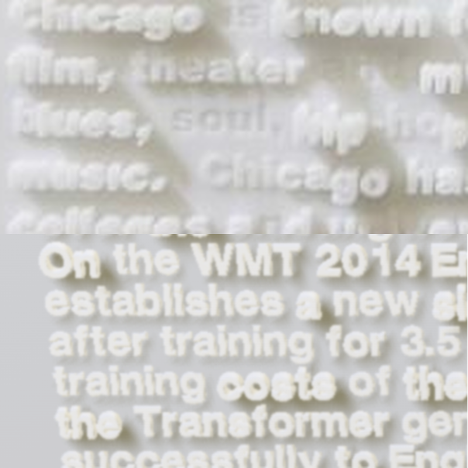
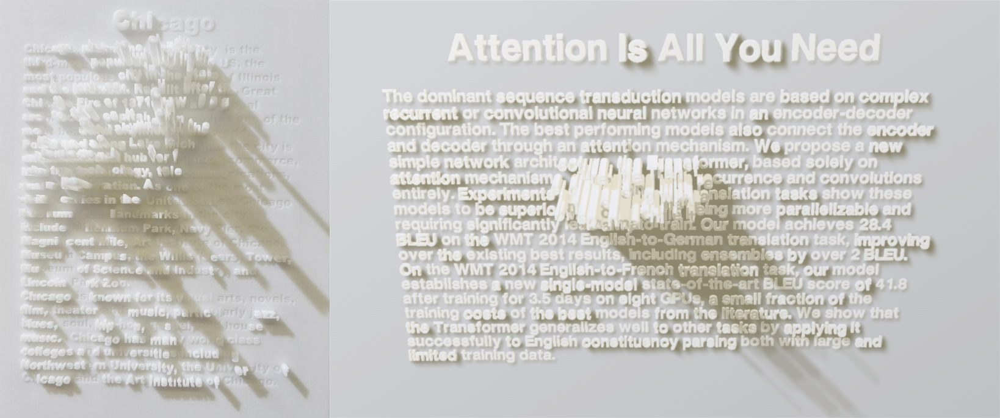
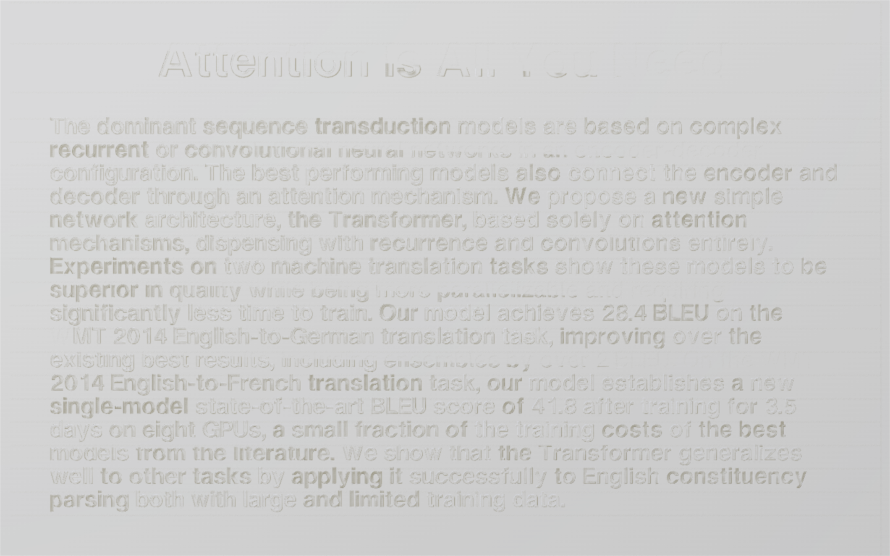
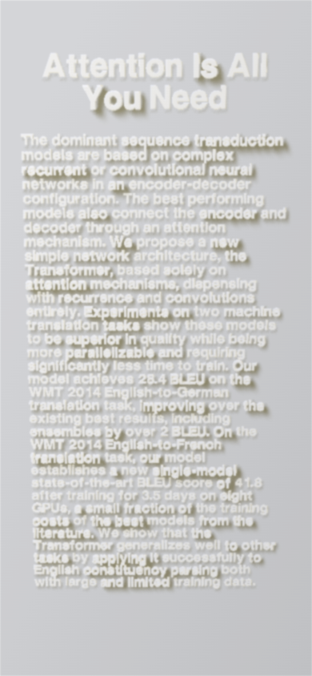
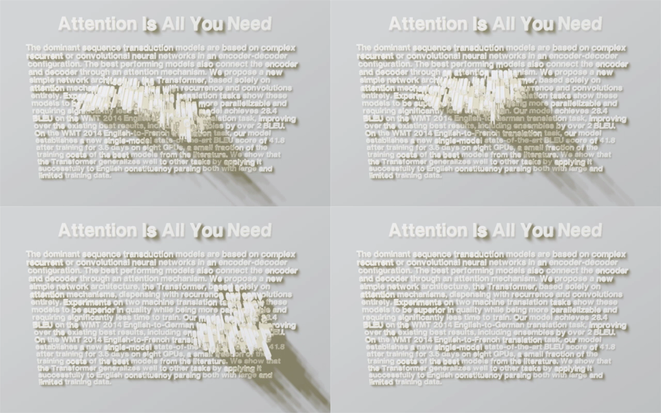

# Extrude type

**Problem.** You want the Chicago relief from your photo as a component: letters of milky stone standing out of a page, with soft warm shadows.
**Result.** `extrude-type`, a Three.js scene where letters under the cursor rise into pale towers, hold for a moment, then sink back.
**Proof.** The working lab preview below, at `.plannotator/extrude-type/play.html` (Proposed preview, not wired into the site).

## Round 3: the marble

You were right that I wasn't seeing it. I was treating the letters as opaque plastic with sharp edges. Up close the photo shows translucent stone, like alabaster:

- **Edges are rounded.** Every glyph has a soft, carved bevel, so light rolls over it instead of breaking at a hard corner. Now each letter has a 5-segment rounded top. A shader keeps that cap the same thickness however tall the letter grows, so towers keep soft tops. The glyphs are also slightly fattened into the photo's puffy letterforms.
- **Light passes through.** Shaded faces never go dark; they glow pale. Letters now have a self-lit share, and it is 3× stronger on the side walls than on the face, so a tower's walls stay white even in a neighbour's shadow. That is what makes the skyline columns read.
- **Shadows are soft.** Light through stone diffuses, so the shade is broad with no hard outline. The round 2 shadows were crisp and made the text look like dark print with a drop shadow. That was the regression. Shadow blur is now 3× wider.
- **The photo itself is soft.** A 0.9px soft focus over the canvas, like the photo's shallow focus.
- **Kept from round 2:** uneven word depths (now skewed so more words sit flush and faint, like "soul" and "and" in the photo), and a moderate 22° camera angle so the raised walls show as columns. Straight-on hides them entirely.

Close-up at matched letter size, photo above, render below:



| Measured | Photo | Now |
| --- | --- | --- |
| Paper, top left | `#D6D6D8` | `#D4D5D8` |
| Letter faces, top 5% | `#E4E4E7` | `#E8E8EA` |
| Resting shadow, darkest 5% | `#9D9889` | `#999683` |

Full frame, photo left, render right with a hover held:



## How it works

```
pointer ─▶ raycast onto page ─▶ per-letter brush (radius 4.5em)
                                        │
                memory: max(brush), holds 0.35s, sinks over 1.5s
                                        │
     aHeight = per-word rest (flush … 0.48em) ─▶ peak 10em × per-letter jitter
                                        │
 rounded glyph, shader stretches body only ─▶ 5 soft key lights + warm fill ─▶ 22° camera, 0.9px soft focus
```

- One rounded glyph per distinct character, instanced. The height is a per-instance attribute read in the vertex shader (and in the shadow pass), so tall towers keep their rounded caps.
- Renders only while something moves. Measured 16.7ms median and p90 frame time during the intro sweep at 1440×900.
- On mount, one phantom brush sweep shows the effect. It's skipped under reduced motion.

## Preview (Proposed)

Rest, 1440×900:


Mobile, 390×844:


Recording at 1280×800: intro sweep, two strokes, then the sink back to rest. [shots/hover.mp4](shots/hover.mp4). The trail looks steppy because the recorder moves the mouse in jumps.



## Still different from the photo

- The photo's tower shadows are stronger, longer streaks. Softening the shadows for the marble look also faded the tall towers' tails. I'd tune this next if the material is right.
- The photo's skyline is one large fixed cluster. Here it follows your cursor and fades.
- On a phone the soft focus costs legibility at small text sizes. It's a prop, so mobile could use less.

## Files after approval

| File | Role |
| --- | --- |
| `src/registry/extrude-type.tsx` | Client component, lab core ported as a hook. Props: `title`, `body`, `radius`, `peak`, `rest`, `hold`, `sink`, `elevation`, `tilt`, `soften`, `glow`, `wallGlow`, `keyColor`, `fillColor`, `intro`, `className`. Renders an sr-only copy of the text, since the canvas is `aria-hidden`. |
| Blob `extrude-type/helvetiker_bold.typeface.json` + `src/lib/assets.ts` | Font served from `/assets/...`. MgOpen licence (free to redistribute with notice). The notice ships inside the JSON. |
| `src/lib/registry.ts` | `registryItems` entry, dependency `three`. |
| `src/components/demos/extrude-type.tsx` + `index.tsx` | Demo with `SliderComfortable` for radius, peak, tilt, soften, and `StudioColor` for key and fill. |
| `src/components/previews/extrude-type.tsx` + `index.tsx` | Fullscreen preview at `/components/extrude-type/preview`. |
| `src/lib/component-meta.ts` | Prop docs. |

## Copy

Title "Attention Is All You Need" and the paper's abstract, verbatim from the arXiv API (1706.03762). Both are props.

## Left out on purpose

- No pixel diff: the photo is a photograph of a physical piece, not a pinned source. The table is measured; the material and shadow shape are my judgement next to it.
- The canvas text can't be selected. The sr-only copy covers screen readers.
