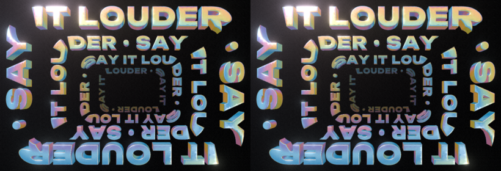
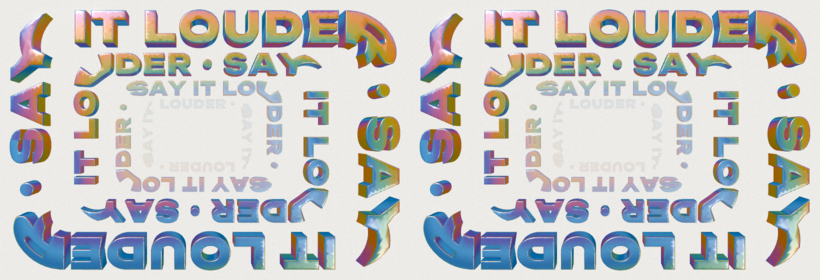

# Gyre: 1:1 port of metalforge.xyz/gyre

**Problem.** You want metalforge's Gyre in the registry: your words in extruded iridescent foil running round their frame, ring behind ring, fading into the ground, following the box live on resize.
**Result.** `gyre`, a React component that runs the source engine unchanged (same shaders, springs, layout solver, bloom and grain), plus a studio whose panel carries every control the source panel has.
**Proof.** The port and the live source, driven through the engine's own `debug` handle at 820×560: **0 differing pixels on all 5 frames** (dark t=0, dark t=3.7, dark with the hand at (0.6, −0.5), light t=0, light t=2 with the hand at (−0.4, 0.3)). Engine stats match exactly too: 144 letters, 296,448 triangles, 2 phrases per ring, q = 1.52899.

## How it works

```
font (opentype) ─► each glyph extruded once ─► instanced mesh (hi cut for rings 0..2, lo cut behind)
                                                    │  per instance: aSig = (arc position, ring k, scale)
box size ─► fit rounded rect + phrases per lap ─► vertex shader walks the rect, bends the letter,
                                                    pushes ring k to depth d0·q^k
scroll += speed·dt (+ wheel push) ──────────────► fragment shader: 7-stop foil ramp, thin film, glints, fog
                                                    └► bloom ► sRGB output ► film grain
```

Source (left) and port (right), dark with the hand off-centre, then light:




Pinned source: `.plannotator/gyre/source/` (page HTML, `engine.min.js` + prettified `engine.js`, the knob schema, the font). Diff script: `verify/diff.sh`.

## Files

| File | Change |
| --- | --- |
| `src/registry/gyre.tsx` | New. The engine (`createGyre`, same handle API as the source) and a `<Gyre>` wrapper that fills its parent; every control is a prop. Already written and diffed as `.plannotator/gyre/gyre.tsx`. |
| `src/components/studios/gyre.tsx` | New. Panel with all controls (below). |
| `src/components/demos/gyre.tsx`, `previews/gyre.tsx` | New. Demo box and fullscreen preview. |
| `src/lib/registry.ts`, `registry-groups.ts`, `component-meta.ts`, `studios/index.tsx`, `demos/index.tsx`, `previews/index.tsx` | Wiring, props docs, nuance notes. |
| `src/lib/assets.ts` | Register `gyre/Unbounded-900.woff`, uploaded to Blob. |
| `package.json` | **New dependency `opentype.js@1.3.4`**, dev dependency `@types/opentype.js`. |

## Decisions for you

1. **Add `opentype.js`.** The source reads glyph outlines, kerning pairs and cap height straight from the font with opentype. Three's own `FontLoader` (what our `extrude-type` uses) takes typeface JSON, which has no kerning table, so the letter spacing would drift. The lab used 1.3.4 and diffed to 0 pixels.
2. **Font on Blob.** Unbounded Black (SIL Open Font License, redistributable) at `/assets/gyre/Unbounded-900.woff`, 27 KB.
3. **Name `gyre`.** No MetalForge name anywhere.
4. **Panel: every source control, in the source's groups, as tabs.**
   - Words: Words (text, 60 max), Between (separator, 4 max), Letter spacing, Word spacing
   - Type: Letter size, Depth, Bevel
   - Rings: Edge room (px), Corner, Gap between rings, Rings, Fade from, Gone at
   - Motion: Speed (letters/s), Wheel push
   - Camera: Lens, Follow the hand, Resize delay (s)
   - Foil: Foil 1 to 7, each with its dark twin, Colour strength, Colour spread, Across a letter, Shift with angle, Colour drift, Sides, Side colour, Pale face
   - Light: Gloss, Glints, Glint (+ dark), Glow, Grain
   - Ground: Light or dark (Follow the page / Light / Dark), Ground (+ dark)
   - **Frame (proposed):** the source studio's size buttons, Phone 390×760, Square 560×560, Tablet 820×560, Wide 1200×680, Fill, so you can watch the rings re-fit. Our stage is a fixed box, so a size larger than the stage is scaled down to fit, like the source does.

   Same ranges, steps and defaults as the source knob table.

## Left out

- The source studio's drag handles on the frame, its zoom buttons, the Code tab, share link and the paid one-line-HTML export. They are MetalForge's editor, not the component. Tell me if you want the drag handles.
- The live source also has `Pile`, a sibling tool sharing the knob table. Not part of this.

## Verify after building

Rerun `verify/diff.sh` against the registry build in the studio route, both themes; screenshot the studio panel in light and dark; resize through every Frame preset and check the ring count settles; `npm test`, `typecheck:registry`, biome on changed paths, `npm run build`.
