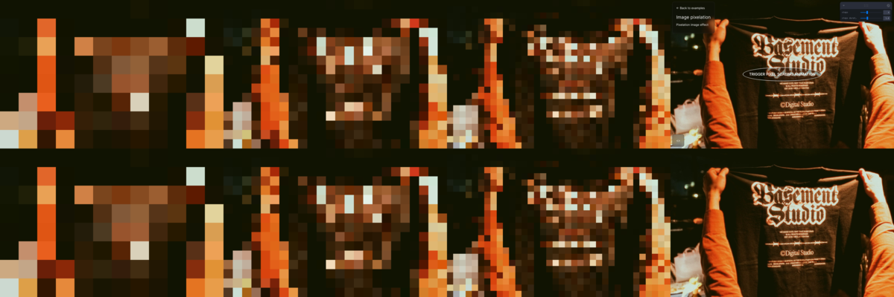

# Image Pixelation: basement.studio lab 61, 1:1

**Problem.** The lab experiment resolves a photo out of big square pixels in five quick steps. You want it as a registry component.
**Result.** `image-pixelation`: a typed React port on a 2D canvas, with no dependencies.
**Proof.** Both pages read the same photo bytes, and their canvases were read back at every step with the 100ms step timer held. RMSE is 0 at rest and 0.0009 to 0.0010 on each step.

## How the source works (pinned in `reference/image-pixelation/`)

- Each step draws the image into the canvas corner at `f`% of its size, then scales that corner back up over the whole canvas with `imageSmoothingEnabled = false`.
- `f` walks `[1, 1, 2, 3, 100]`: four Fibonacci terms plus full size. Each step holds for `100ms × stepsDuration`. Then the canvas hides and the `` shows, and it stays sharp.
- The canvas is sized in CSS pixels, so the blocks are the same size at any DPR.
- At rest the live page shows **nothing**. Its first draw runs before Next's image has decoded, so the canvas stays empty and the image sits at opacity 0 until the trigger button is clicked (`evidence/source-rest-page.png`).

## Evidence: source (top) vs port (bottom), steps 1%, 2%, 3% and the end state

| step | rest | 1% | 1% | 2% | 3% | 100% |
| --- | --- | --- | --- | --- | --- | --- |
| RMSE | 0 | 0.0009 | 0.0009 | 0.0010 | 0.0010 | 0.0010 |

Method: `verify/steps.js` holds every 100ms timeout until `__next()`. `verify/capture.sh` clicks each page's trigger and reads the canvas back with `toDataURL` after every step. The source draws Next's AVIF re-encode (`/_next/image?…&q=75`), not the raw JPEG, so those exact bytes are pinned as `reference/image-pixelation/10.next.avif` and the lab draws them. The first comparison against the raw JPEG gave 0.017.

## Decisions

1. **Default image.** The source photo is a "Basement Studio" t-shirt, so it can't ship. I propose BLANK's heat-label beanie render from the agency repo (`mockups/out/v7/beanie-heat.jpg`, resized to the source's 2738×1825, 710 KB). It's a similar shot, hands holding a dark garment, and it carries our BI mark.
2. **Trigger.** The source starts on a lab button. The component defaults to `trigger="inView"` with `initial="hidden"`, which matches what the page shows: an empty box, then the steps, then the photo. `click`, `hover` and `manual` (through a ref `play()`) are props.

## Props

`src`, `alt`, `steps` (4), `stepsDuration` (1), `trigger` ("inView"), `initial` ("hidden" | "pixelated" | "sharp"), `ratio` (the image's own), `fit` ("cover", only used when `ratio` differs), `onComplete`, `className`, `style`. Under reduced motion `play()` jumps to the sharp image.

## Omissions

- The lab's Leva panel and trigger button are page chrome.
- The source never redraws on resize. The port redraws only in `initial="pixelated"`, because that is the only state where a stale canvas stays on screen.
