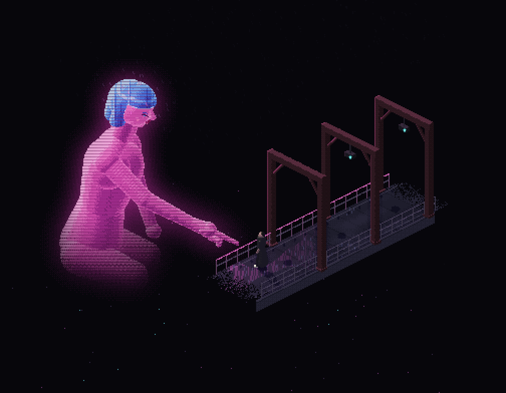
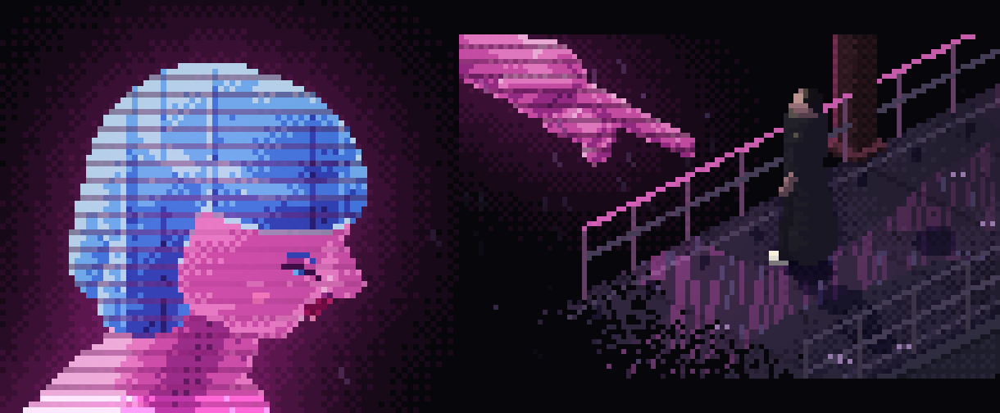
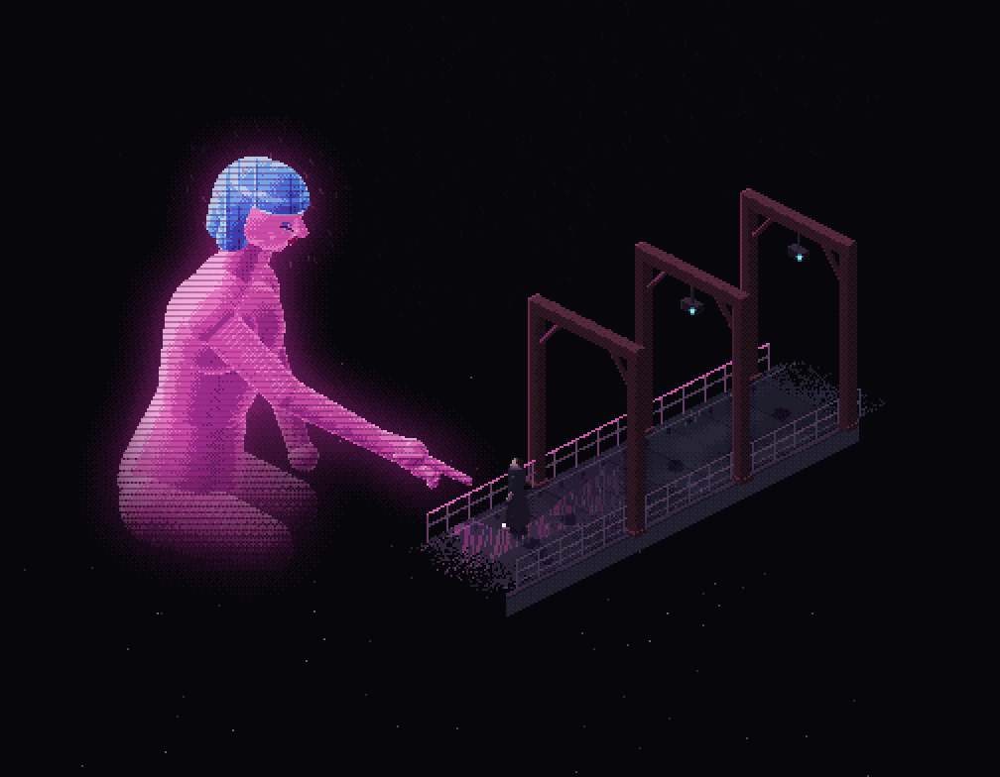

# Hologram walkway: an isometric pixel component

## 1. Goal

- **Problem.** You want the giant-hologram scene from Blade Runner 2049 as a compronents component, in the isometric-pixel-games style, on black, with the giant woman in real detail.
- **Result.** A `hologram-walkway` registry item: a live pixel diorama of a rainy walkway, a small figure in a long coat, and a translucent giant with a blue bob reaching down to point at him.
- **Proof.** The isolated preview below runs on the skill's engine. Her head and hand were built first, since they decide whether the idea works at pixel scale.

Original adaptation, not a frame copy: the shot is reframed for a fixed isometric camera, so there is no pixel diff against the film still. Reference pinned at `reference/scene.png`.

## 2. Proposed preview

Preview: `.plannotator/joi-hologram/preview/index.html` (open as a file, no server). Canvas 504x392, shown at 2x.



Head and hand at 7x and 6x. Straight-cut fringe, blue bob ending at the chin, lowered eye with lash line and lid, nose and lips forming the profile, index finger out with three curled fingers and a thumb.



Motion, 2 seconds (rain, scanline sweep, lamp, one glitch slice): [loop.gif](evidence/loop.gif)



How it is drawn:

```
bake once ─┬─ deck (wet concrete, pink spill, puddle streaks), railings, 3 steel portal frames, K
           ├─ hologram into its OWN buffer (colour, depth, alpha): body, bob, face, hand
           └─ pink glow = blurred hologram mask, quantised to stay pixel art
per frame ─┬─ hologram composited over the scene: translucent, scanlines, sweep band, flicker, rare glitch rows
           └─ rain (lit only near her), splashes, lamps
```

## 3. Decisions to approve

1. **Black page.** You asked for it, and it overrides the skill's pure-white rule. The ragged deck ends dissolve into black instead of white.
2. **More pixels: 504x392 at 14 px per world unit** instead of the skill's 360x280 at 10. Her face is about 40 px across, enough for eye, brow, nose, lips. Still nearest-neighbour, integer scale only.
3. **Composition.** She kneels left, in profile, turned slightly toward the viewer; the walkway recedes up and right like the film; K stands under her finger. Three steel portal frames with knee braces and hanging teal lamps (the first try read as shrine gates, so they were redrawn).
4. **The hologram is light, not solid.** Own depth buffer, about 90% opacity, every third row dimmed, a bright band sweeping down, slight flicker, and every 4 to 9 seconds a glitch shifts a few rows sideways for 0.12 s. The face keeps more of its scanline rows so features survive.
5. **Tasteful by construction.** Her body is a smooth form with no anatomical detail, and below the waist she fades into the void. The pointing arm crosses her chest.
6. **Motion goes beyond the skill's "plants only" rule** on purpose: rain, the hologram effects and the lamps are the scene. `prefers-reduced-motion` gives one still frame.
7. **Neutral naming.** Registry name `hologram-walkway`, no film or character name in the item, per the brand rule. The description can say it is a tribute to the scene; I will draft the copy with your voice guide during implementation.
8. **No studio panel.** Three props only: `rain` (0 to 1), `glitch` (on/off), `paused`. Add a panel later if you want to tune it.

## 4. Files

| File | Role |
| --- | --- |
| `src/registry/hologram-walkway/engine.ts` | The Pixel Plays renderer ported to an instance (`createRenderer({ W, H, S, originX, originY, shadow })`), no globals, MIT header kept |
| `src/registry/hologram-walkway/scene.ts` | Everything in the preview: deck, frames, K, hologram, face, glow, rain, glitch |
| `src/registry/hologram-walkway/index.tsx` | `<HologramWalkway />`: canvas sized to its box at integer scale (ResizeObserver), paused off screen (IntersectionObserver), reduced-motion still |
| demo, preview, `registry.ts`, `component-meta.ts`, `registry-groups.ts` | Standard wiring, same as `watercolor` |

The engine changes against upstream are three lines: `W`, `H`, `S` and `originX` read from the scene config, defaults unchanged.

## 5. Not covered yet

- Small finish items I will do during implementation: K's shoes render white (engine default), add a pink rim on his near side, and soften the mottling inside her torso.
- "A good website for this": I am reading that as the component's page on ui.aryank.space. If you meant a separate standalone site, say so here.
- No sound.
- Verified only in headless Chrome at 2x. Mobile layout and Safari get checked after implementation.
