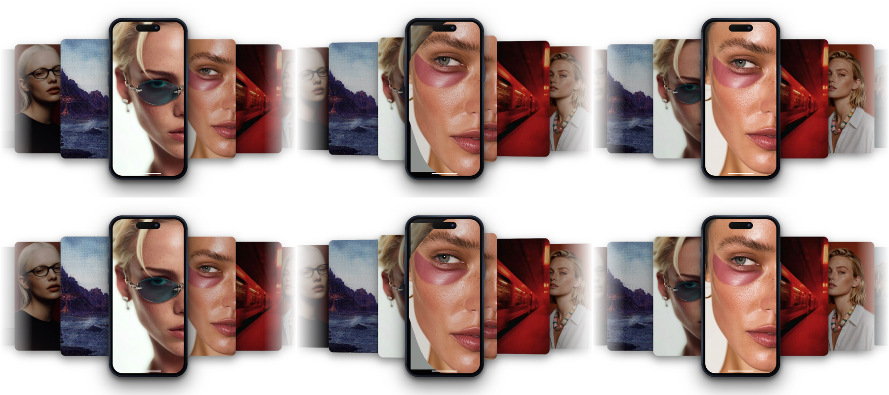
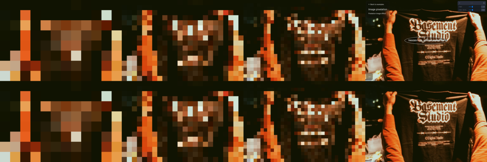
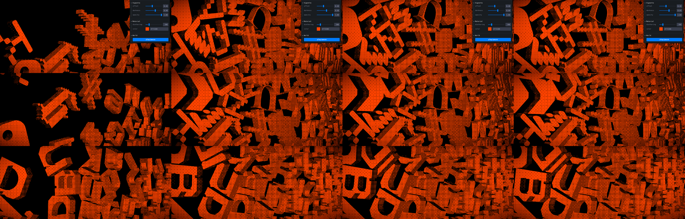
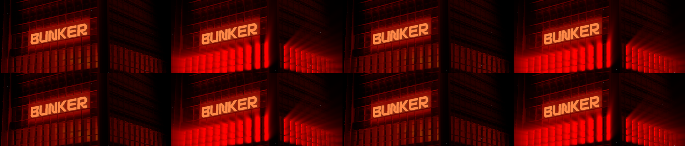
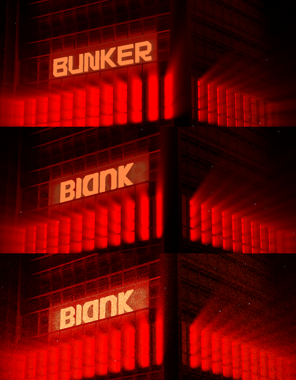

# Four ports: review

Four components, each ported from its live source and checked against it. Nothing is wired into `src/` yet, and nothing is uploaded or committed. Approving this plan approves the decisions below. After that I upload the assets, add each item to the registry (source, demo, preview, meta, assets, group), run `npm test`, `typecheck:registry`, `biome` and `npm run build`, and check each page in the browser.

## Decisions to approve

| component | decision | recommendation |
| --- | --- | --- |
| phone-stack-carousel | defaults | the live page's look: ink phone, no status bar, no dots, white backdrop |
| phone-stack-carousel | media | upload the page's 5 images and 3 videos (about 10 MB) to Blob |
| image-pixelation | default image | BLANK heat-label beanie render (the source photo is a "Basement Studio" t-shirt) |
| image-pixelation | trigger | `inView`, starting hidden, which matches what the source page shows |
| glyph-rain | letters | BLANK wordmark letters in a repeating B L A N K band (the source glyphs spell another studio's name) |
| glyph-rain | physics | matter-js, already a dependency, instead of rapier (WASM) |
| bunker-scene | sign | BLANK mark with BUNKER's letter spacing, scaled to match its lit area (same brightness) |
| bunker-scene | model | ship the source model with the letter meshes removed, as `bunker-scene/bunker.glb` |

Note: the basement lab repo has no licence file. Its code, `glyphs.glb`, `bunker.glb` and facade texture carry no stated reuse terms. The carousel's media comes from the Framer page.


---

## Phone Stack Carousel: phonestackcarousel.framer.website, 1:1

**Problem.** The Framer page has a phone mockup that rides a spring through a fanned stack of slides. You want it as a registry component.
**Result.** `phone-stack-carousel`: a typed React port of the page's Framer code component. It is plain DOM and CSS with no dependencies and no iframe.
**Proof.** Both pages ran on the same frozen clock and got the same keypress. RMSE against the live site is 0.0011 to 0.0023 (under 0.6/255) across the settled state and 7 frames of a transition.

### How the source works (pinned in `reference/phone-stack-carousel/carousel.pretty.js`)

```
goal (autoplay 3.2s, drag/flick, wheel, arrows, card click)
  └─► spring: k 110, ζ 1, 3 substeps/frame ──► pos
        ├─► cards: x = first + (|d|-1)·step, scale 1-0.08|d|, dim 0.45·|d|/3, rotateY = -vel·2.4 (±6°)
        └─► screen: frac(pos) → sine ease → 60-point circle from the right edge,
                     radius wobble 0.11·sin(πt) (two harmonics), outgoing slide scales to 0.93 and dims
```

- Every length is `calc(var(--u) * n)` with `--u = min(1cqh, 1.95cqw)` on a size container, so the scene scales with the component box.
- The phone is about 15 stacked divs (band gradient, seam, glass, screen, island, keys, notches, rim), with no images.
- It runs only while on screen and with the tab visible. Under reduced motion it snaps and stops autoplay.

### Evidence: source (top) vs port (bottom), 1200×800

Settled, frame 12 after ArrowRight, frame 90.



| state | RMSE |
| --- | --- |
| settled | 0.0023 |
| f004 | 0.0017 |
| f008 | 0.0014 |
| f012 | 0.0011 |
| f018 | 0.0012 |
| f026 | 0.0013 |
| f040 | 0.0014 |
| f090 | 0.0014 |

Method: `phone-stack-carousel/verify/clock.js` replaces `performance.now` and `requestAnimationFrame` with a manual clock after `__freeze()`, drops the 3.2s autoplay timer and holds every video at 1.0s. `phone-stack-carousel/verify/capture.sh` drives both pages through agent-browser and runs `magick compare`. The Framer badge is hidden on the source. As a control, source settled vs source f012 is 0.244, so the frames do move.

### Files (after approval)

| file | change |
| --- | --- |
| `src/registry/phone-stack-carousel.tsx` | the port from this folder |
| `src/components/demos/…`, `previews/…` + both `index.tsx` | demo (680px tall) and fullscreen preview |
| `src/lib/registry.ts`, `registry-groups.ts`, `component-meta.ts`, `assets.ts` | entry, group, props docs, 8 Blob assets |
| Blob `phone-stack-carousel/*` | the page's 5 images and 3 videos (2.4 MB, 0.3 MB, 5.8 MB), renamed by slide title |

### Decisions

1. **Defaults are the live page's settings, not the code component's.** The page sets ink finish, no status bar, no dots and a white backdrop. The code's own defaults are obsidian, status bar on, dots on and `#08080A`. The demo should look like the page you linked, so the port uses the page values. Every other look is still available as a prop.
2. **Slide media.** The plan is to upload the page's own 8 media files to Blob so the default matches. That is about 10 MB, mostly the two longer videos.

### Omissions and limits

- Framer's static canvas renderer (`ro` in the source) is left out. It only draws a still in the Framer editor.
- The props are grouped the same way as Framer's property controls (`device`, `cards`, `motion`, `surface`, `indicator`), and those groups are typed objects.
- Input was diffed under the same frozen clock (`phone-stack-carousel/verify/input.sh`, `evidence/input-strip.png`). A 10-frame 340px drag left scored 0.0008, a 700px wheel 0.0004 and a click on the second card left 0.0005. All three land on the same slide as the source. A real-time run could not decide this, because flick velocity depends on event timing and the two pages run at different speeds headless.

---

## Image Pixelation: basement.studio lab 61, 1:1

**Problem.** The lab experiment resolves a photo out of big square pixels in five quick steps. You want it as a registry component.
**Result.** `image-pixelation`: a typed React port on a 2D canvas, with no dependencies.
**Proof.** Both pages read the same photo bytes, and their canvases were read back at every step with the 100ms step timer held. RMSE is 0 at rest and 0.0009 to 0.0010 on each step.

### How the source works (pinned in `reference/image-pixelation/`)

- Each step draws the image into the canvas corner at `f`% of its size, then scales that corner back up over the whole canvas with `imageSmoothingEnabled = false`.
- `f` walks `[1, 1, 2, 3, 100]`: four Fibonacci terms plus full size. Each step holds for `100ms × stepsDuration`. Then the canvas hides and the `` shows, and it stays sharp.
- The canvas is sized in CSS pixels, so the blocks are the same size at any DPR.
- At rest the live page shows **nothing**. Its first draw runs before Next's image has decoded, so the canvas stays empty and the image sits at opacity 0 until the trigger button is clicked (`evidence/source-rest-page.png`).

### Evidence: source (top) vs port (bottom), steps 1%, 2%, 3% and the end state



| step | rest | 1% | 1% | 2% | 3% | 100% |
| --- | --- | --- | --- | --- | --- | --- |
| RMSE | 0 | 0.0009 | 0.0009 | 0.0010 | 0.0010 | 0.0010 |

Method: `image-pixelation/verify/steps.js` holds every 100ms timeout until `__next()`. `image-pixelation/verify/capture.sh` clicks each page's trigger and reads the canvas back with `toDataURL` after every step. The source draws Next's AVIF re-encode (`/_next/image?…&q=75`), not the raw JPEG, so those exact bytes are pinned as `reference/image-pixelation/10.next.avif` and the lab draws them. The first comparison against the raw JPEG gave 0.017.

### Decisions

1. **Default image.** The source photo is a "Basement Studio" t-shirt, so it can't ship. I propose BLANK's heat-label beanie render from the agency repo (`mockups/out/v7/beanie-heat.jpg`, resized to the source's 2738×1825, 710 KB). It's a similar shot, hands holding a dark garment, and it carries our BI mark.
2. **Trigger.** The source starts on a lab button. The component defaults to `trigger="inView"` with `initial="hidden"`, which matches what the page shows: an empty box, then the steps, then the photo. `click`, `hover` and `manual` (through a ref `play()`) are props.

### Props

`src`, `alt`, `steps` (4), `stepsDuration` (1), `trigger` ("inView"), `initial` ("hidden" | "pixelated" | "sharp"), `ratio` (the image's own), `fit` ("cover", only used when `ratio` differs), `onComplete`, `className`, `style`. Under reduced motion `play()` jumps to the sharp image.

### Omissions

- The lab's Leva panel and trigger button are page chrome.
- The source never redraws on resize. The port redraws only in `initial="pixelated"`, because that is the only state where a stale canvas stays on screen.

---

## Glyph Rain: basement.studio lab 34, ported with BLANK letters

**Problem.** In the lab experiment, 72 extruded glyphs fall into a box and pile up, drawn through an 8×8 ordered dither in one orange. You want it as a registry component, and the source glyphs spell another studio's name.
**Result.** `glyph-rain`: a typed React component on vanilla three, postprocessing, gsap and matter-js. All four are already in the repo, so no new packages. The letters are cut from the new BLANK wordmark.
**Proof.** With the source's own `glyphs.glb` loaded in the port, the settled pile matches the source on colour (peak exactly 255,67,0), lit coverage (0.526 vs 0.534) and dither pitch. The pile itself is random on both pages, so it is measured, not pixel-diffed.

### How the source works (pinned in `reference/svg-rain/`)

- 9 rows × 8 glyphs at `scale 0.05`, spaced 2.1 apart. Row `i` spawns at `y = 4.2i + 2r + 7.5` with z rotation `π/2 + πr`, where `r` is random per glyph.
- Rapier with gravity −4 and hull colliders. Translation is locked to x/y and rotation to z, so the physics is planar. Floor top at y = 0, wall inner faces at x = ±8.5.
- Shader: Lambert `max(dot(N, L), 0)` from a light at (−7.98, 4.27, 5.46), quantised by glsl-dither 8x8 at `gl_FragCoord / clientHeight × 200`, times `#ff4300`. Then a vignette (offset 0.4, darkness 0.6).
- Camera fov 20 at a fixed pose, eased by the cursor over 0.198s with power2.out (±0.9°). The light follows by ±1 in x and ±2 in y.
- The transform gizmo, Stats panel, Leva panel and "lights" sliders are lab chrome. The shader never reads the lights.

### How the port maps it

- **Physics in matter-js.** Each glyph's collider is the 2D convex hull of its vertices at 50 px per world unit. Rapier's defaults carry over: friction 0.5, restitution 0, no damping. Gravity scale is `4 × 50 / 1e6`. It steps at a fixed 1/60s. Bodies sit at the hull centroid, and each mesh is offset back to its origin.
- **Shader** copied with the Bayer thresholds verbatim, and the same CSS-height dither scale.
- **BLANK letters.** The wordmark's five shapes are cut left to right (B, l, a, n, k), extruded 7.3 deep and scaled to 25 tall, the source glyph size. The rows repeat B L A N K across 9 × 8.

### Evidence (1200×800, canvas 1200×514)

Columns are 1.5s, 2.5s, 3.5s and 9s after load. Rows are source, port with source glyphs (`?original`) and port with BLANK.



| settled (9s), left 800px | lit fraction | peak RGB |
| --- | --- | --- |
| source | 0.534 | 255, 67, 0 |
| port, source glyphs | 0.526 | 255, 67, 0 |
| port, BLANK | 0.534 | 255, 67, 0 |

Dither, source left and port right, 8× zoom: `evidence/dither-zoom.png`. Same cell size and dot pitch.

### Decisions

1. **Letters.** The source rows spell the other studio's name, which this repo can't show. I propose the BLANK wordmark letters in a repeating B L A N K band (`evidence/blank-cmp.png`). The `rows` and `loadGlyphs` props take any glyph set.
2. **Physics engine.** matter-js instead of rapier, so no WASM package gets added. The two solvers settle differently, so the pile shape differs on every run, as it already does between two runs of the source.

### Props

`rows`, `loadGlyphs`, `markUrl`, `color` (#ff4300), `ditherSize` (200), `gravity` (4), `vignetteOffset` (0.4), `vignetteDarkness` (0.6), `paused`, `ratio` (21/9), `className`, `style`, plus a ref `replay()`. It renders only on screen and stops drawing once the pile is still. Under reduced motion it solves the fall off screen and shows the settled pile.

### Omissions and limits

- Not pixel-diffed. Spawn uses `Math.random`, and three's UUIDs draw from the same generator in an order I can't line up between the two pages.
- Cursor coordinates are normalised to the component box. The source uses the window, which only matters when the canvas doesn't fill the window.
- The play/pause button is lab chrome. Use the `paused` prop.

---

## Bunker Scene: basement.studio lab 32, with the BLANK sign

**Problem.** The lab experiment is a red-lit bunker facade with a glowing "BUNKER" sign. A hidden sun flickers on and throws god rays through the windows. You want it as a component with the new BLANK wordmark as the sign.
**Result.** `bunker-scene`: a typed React component on vanilla three, postprocessing and gsap. All three are already in the repo, so no new packages and no react-three-fiber. The sign is the BLANK mark (`blank-rand.svg` from the agency repo), extruded with its counters cut out.
**Proof.** With the source's own letters loaded (`?original`), both pages ran on the same frozen clock with the same particle positions and the noise off. RMSE is 0.009 to 0.011 across the whole flicker.

### How the source works (pinned in `reference/bunker-scene/`)

- A fov 10 camera on a fixed pose orbits on a 40s ellipse. The cursor takes over and eases with power2.out over 0.49s, and the orbit resumes 2.5s after the last move.
- A hidden red box (the "sun") sits behind the facade. A gsap timeline turns it on at 2.5s, then off, on, off, on in 0.05s and 0.2s steps.
- That box is the light source for GodRays (100 samples, density 0.9, decay 0.92, weight 0.4, exposure 0.4, Kawase blur), blended with screen.
- 1000 additive points drift on 2D simplex noise. A colour-dodge film noise at 0.75 sits on top.
- The god rays follow postprocessing 6.36, the version the source shipped. In 6.36 the light is drawn alone at half resolution and masked against scene depth. 6.37 and later change the shafts, so the port carries that version's effect as a small class.

### Evidence

Flicker, source (top) vs port with the source letters (bottom): sun off (f060), on (f152), off (f155), lit (f180).



| frame | f060 | f152 | f155 | f158 | f165 | f180 | settled |
| --- | --- | --- | --- | --- | --- | --- | --- |
| RMSE | 0.0093 | 0.0107 | 0.0095 | 0.0106 | 0.0092 | 0.0105 | 0.0113 |

Method: `bunker-scene/verify/clock.js` steps both pages frame by frame from their first scene frame. The source's particle positions are read out and injected into the port, particle drift is held at 0 on both, and film noise is off on both. `bunker-scene/verify/capture.sh noise` runs the same capture with noise on.

The BLANK sign. Rows are source (noise off), BLANK (noise off) and BLANK as shipped (noise on):



### The sign swap

- The six letter meshes (B, U, N, K, E, R on material LIGHT) are removed. The BLANK mark replaces them with the same node transform and the same LIGHT material, and it is extruded over the letters' own depth.
- **Spacing.** The gaps between letters go from 22 to 44 SVG units (`MARK_GAP`), which copies BUNKER's gap-to-height ratio of 0.18.
- **Size.** The mark is scaled so its lit face area equals BUNKER's: 122,202 units², summed from the letter faces in bunker.glb (`SIGN_FACE_AREA`). It ends up 215 local units tall against BUNKER's 189, centred on the same box. The letter faces measure 255, 135, 70 in both renders. Measured over the sign region:

| sign | lit letter pixels | mean luminance |
| --- | --- | --- |
| BUNKER (source) | 19,950 | 67.0 |
| BLANK, height fit (first pass) | 15,155 | 61.6 |
| BLANK, area fit (shipped) | 19,035 | 66.5 |
- **Shipped model.** `bunker-blank.glb` (952 KB) is the source model without the letter meshes. It is not Draco compressed, so the component fetches no external decoder.
- **Baked glow.** The facade texture bakes a BUNKER glow into the panel behind the sign. With noise off, no letter shapes show around BLANK. The glow is diffuse and reads as the same lit panel the source has.

### Decisions

1. **Sign size and spacing.** The sign uses BUNKER's letter spacing and matches its lit area, so it is about as bright as BUNKER (66.5 vs 67.0 mean luminance). The first pass fitted it to BUNKER's height and read dimmer (61.6).
2. **Assets.** I plan to upload `bunker-blank.glb` to Blob as `bunker-scene/bunker.glb`. The source's BUNKER model stays in `reference/` only, for the comparison.

### Props

`modelSrc`, `dracoDecoderPath`, `sign` ("blank" | "model"), `sunColor` (#ff0000), `godRays` (partial of the source settings), `noiseOpacity` (0.75), `particleCount` (1000), `particleSize` (25), `particleSpeed` (0.1), `particleDisplacement` (0.5), `rotationStrength` (1), `className`. It renders only while on screen. Under reduced motion the sun is lit from the start and the camera holds still.

### Omissions and limits

- The lab's Leva panel is chrome.
- The cursor is normalised to the component box, where the source uses the window.
- The noise-on frames are random per frame and were not diffed.
