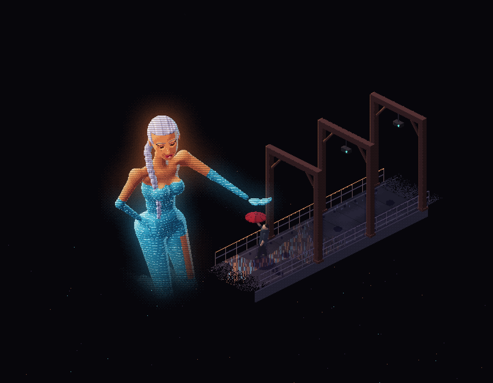
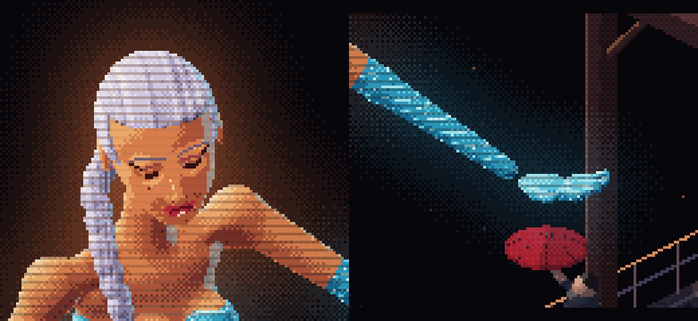

# Rain catcher: an isometric pixel component

## 1. Goal

- **Problem.** The first giant was built from stacked spheres: no human proportions, no detail, and too close to a film character.
- **Result.** A `rain-catcher` registry item. An original giant woman made of amber light, in a strapless gown and opera gloves woven from cyan light, holds her open palm over a small courier with a red umbrella on a rainy walkway. The rain falls through her hand.
- **Proof.** The isolated preview below. She is a ray-marched model now, so the body and face are smooth, proportioned forms instead of balls.

## 2. Proposed preview

Preview: `.plannotator/rain-catcher/preview/index.html` (open as a file). Canvas 720x560, shown at 2x.



Head and hand at 5x: silver hair pulled back into a long braid, half-lidded eyes with lashes and a winged corner, thin lifted brows, shadow on the lids, full glossy lips, a beauty mark, cyan rim light from the walkway lamps.



Motion, 2 seconds (rain, scanline sweep, lamps, one glitch): [loop.gif](evidence/loop.gif)


How she is made:

```
40 smooth primitives, blended ─┬─ torso: pelvis, waist, rib cage, bust, collarbones, long neck
                               ├─ arms: one reaching palm-up, one hand on the hip, elbow out
                               ├─ head: skull, cheekbones, jaw, chin, brow, eye sockets, eyes, lids, nose, lips, ears
                               └─ hair: sleek cap with a side wave, a 40-segment braid over one shoulder
ray-marched once at load ──────┬─ normals, ambient occlusion, warm key light, cyan rim, edge glow
                               └─ material by body part: skin, face, lips, eyes, hair, gown with light threads
painted on top ────────────────── lash line and wing, brows, lid shadow, nose, lip parting and gloss, beauty mark
```

## 3. Decisions to approve

1. **Original character.** Amber skin light, cyan gown, silver braid, a courier with a red umbrella. No film character, palette or shot.
2. **Glamour, not explicit.** Narrow waist, hip curve, bare shoulders, sweetheart neckline, a high slit on the near thigh, opera gloves, a hand on her hip. No nudity.
3. **720x560 at 20 px per unit.** Her head is about 50 px tall. Still nearest-neighbour at integer scale. Black page.
4. **Bake cost.** Ray-marching her takes about 2.8 s once at load on this Mac. In the component that runs in a Web Worker so the page never blocks, with the walkway drawn first.
5. **Hologram effects.** 92% opacity, every third row dimmed (less on the face), a sweeping band, light flicker, a glitch every 4 to 9 s. Rain turns gold inside her light. Reduced motion gives one still frame.
6. **Props:** `rain` (0 to 1), `glitch` (on/off), `paused`. No studio panel.

## 4. Files

| File | Role |
| --- | --- |
| `src/registry/rain-catcher/engine.ts` | Pixel Plays renderer as an instance, MIT header kept; four config fields added (size, scale, originX, shoe colour) |
| `src/registry/rain-catcher/giant.ts` | Her distance model and ray marcher, runnable in a worker |
| `src/registry/rain-catcher/scene.ts` | Walkway, frames, courier, umbrella, rain, glow, compositing |
| `src/registry/rain-catcher/index.tsx` | `<RainCatcher />`: integer-scaled canvas, worker bake, off-screen pause, reduced motion |
| demo, preview, `registry.ts`, `component-meta.ts`, `registry-groups.ts` | Standard wiring |

## 5. Known gaps

- **Her open hand** reads as one shape at 1x. Next pass: separate the fingers with shadow gaps, curl the tips up.
- Below the thighs she fades into the dark on purpose; the kneeling legs are modelled but mostly invisible.
- Checked in headless Chrome only. Mobile and Safari after implementation.
