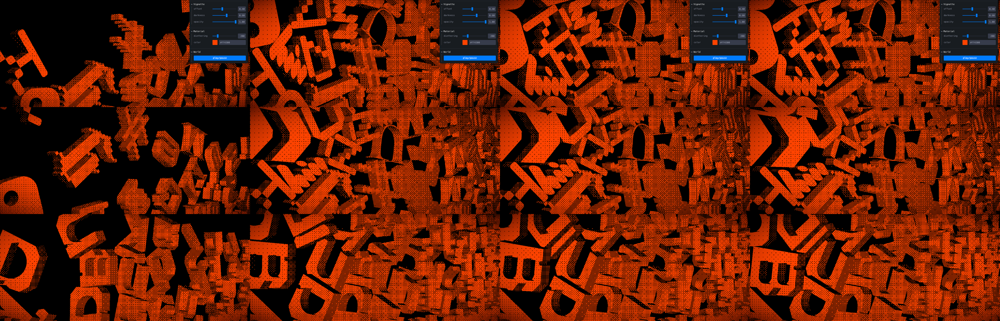

# Glyph Rain: basement.studio lab 34, ported with BLANK letters

**Problem.** In the lab experiment, 72 extruded glyphs fall into a box and pile up, drawn through an 8×8 ordered dither in one orange. You want it as a registry component, and the source glyphs spell another studio's name.
**Result.** `glyph-rain`: a typed React component on vanilla three, postprocessing, gsap and matter-js. All four are already in the repo, so no new packages. The letters are cut from the new BLANK wordmark.
**Proof.** With the source's own `glyphs.glb` loaded in the port, the settled pile matches the source on colour (peak exactly 255,67,0), lit coverage (0.526 vs 0.534) and dither pitch. The pile itself is random on both pages, so it is measured, not pixel-diffed.

## How the source works (pinned in `reference/svg-rain/`)

- 9 rows × 8 glyphs at `scale 0.05`, spaced 2.1 apart. Row `i` spawns at `y = 4.2i + 2r + 7.5` with z rotation `π/2 + πr`, where `r` is random per glyph.
- Rapier with gravity −4 and hull colliders. Translation is locked to x/y and rotation to z, so the physics is planar. Floor top at y = 0, wall inner faces at x = ±8.5.
- Shader: Lambert `max(dot(N, L), 0)` from a light at (−7.98, 4.27, 5.46), quantised by glsl-dither 8x8 at `gl_FragCoord / clientHeight × 200`, times `#ff4300`. Then a vignette (offset 0.4, darkness 0.6).
- Camera fov 20 at a fixed pose, eased by the cursor over 0.198s with power2.out (±0.9°). The light follows by ±1 in x and ±2 in y.
- The transform gizmo, Stats panel, Leva panel and "lights" sliders are lab chrome. The shader never reads the lights.

## How the port maps it

- **Physics in matter-js.** Each glyph's collider is the 2D convex hull of its vertices at 50 px per world unit. Rapier's defaults carry over: friction 0.5, restitution 0, no damping. Gravity scale is `4 × 50 / 1e6`. It steps at a fixed 1/60s. Bodies sit at the hull centroid, and each mesh is offset back to its origin.
- **Shader** copied with the Bayer thresholds verbatim, and the same CSS-height dither scale.
- **BLANK letters.** The wordmark's five shapes are cut left to right (B, l, a, n, k), extruded 7.3 deep and scaled to 25 tall, the source glyph size. The rows repeat B L A N K across 9 × 8.

## Evidence (1200×800, canvas 1200×514)

Columns are 1.5s, 2.5s, 3.5s and 9s after load. Rows are source, port with source glyphs (`?original`) and port with BLANK.

| settled (9s), left 800px | lit fraction | peak RGB |
| --- | --- | --- |
| source | 0.534 | 255, 67, 0 |
| port, source glyphs | 0.526 | 255, 67, 0 |
| port, BLANK | 0.534 | 255, 67, 0 |

Dither, source left and port right, 8× zoom: `evidence/dither-zoom.png`. Same cell size and dot pitch.

## Decisions

1. **Letters.** The source rows spell the other studio's name, which this repo can't show. I propose the BLANK wordmark letters in a repeating B L A N K band (`evidence/blank-cmp.png`). The `rows` and `loadGlyphs` props take any glyph set.
2. **Physics engine.** matter-js instead of rapier, so no WASM package gets added. The two solvers settle differently, so the pile shape differs on every run, as it already does between two runs of the source.

## Props

`rows`, `loadGlyphs`, `markUrl`, `color` (#ff4300), `ditherSize` (200), `gravity` (4), `vignetteOffset` (0.4), `vignetteDarkness` (0.6), `paused`, `ratio` (21/9), `className`, `style`, plus a ref `replay()`. It renders only on screen and stops drawing once the pile is still. Under reduced motion it solves the fall off screen and shows the settled pile.

## Omissions and limits

- Not pixel-diffed. Spawn uses `Math.random`, and three's UUIDs draw from the same generator in an order I can't line up between the two pages.
- Cursor coordinates are normalised to the component box. The source uses the window, which only matters when the canvas doesn't fill the window.
- The play/pause button is lab chrome. Use the `paused` prop.
