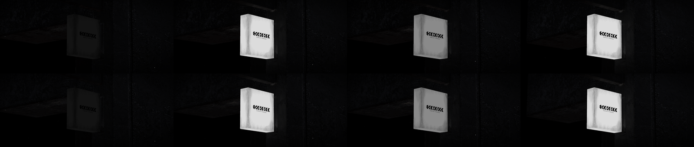
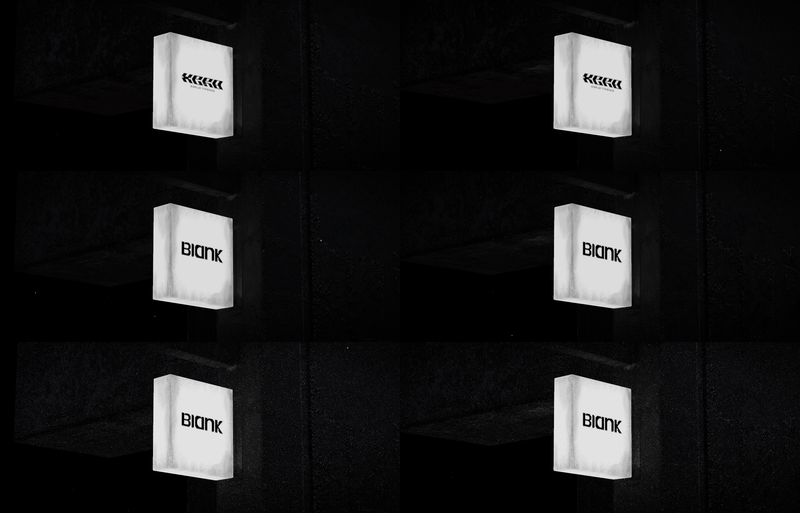

# Neon Sign Scene: basement.studio lab 36, with the BLANK sign

**Problem.** The lab experiment is a lightbox sign hanging in a dark room corner. Two seconds in, the sign flickers on and lights the room, and reflections of moving lights sweep across the walls. You want it as a component with the BLANK wordmark on the sign.
**Result.** `xero-scene.tsx`, named neon-sign-scene in copy: a typed React component on vanilla three, postprocessing and gsap, all already in the repo. No new packages, no react-three-fiber, no drei. The sign texture is redrawn at load with the full BLANK mark.
**Proof.** With the source's own sign loaded (`?original`), both pages ran on the same frozen clock with the same particles and noise off. RMSE is 0.0048 to 0.0063 on all 12 frames, against 0.037 between two settled source frames 1s apart. Per-frame logs of the neon value match on every frame, and the camera matches within 0.001 units.

## How the source works (pinned in `reference/xero-scene/`)

- Locked versions (`lab-yarn.lock`): three 0.159, drei 9.109.2, @react-three/postprocessing 2.16.2, postprocessing 6.36.0, gsap 3.11.1.
- A fov 10 camera (near 0.1, far 10) looks up at the sign. It orbits on a 39.5s ellipse (x times 1/30, y times 1/40, times pi). The cursor eases it with power2.out over 0.49s, and the orbit resumes 2.5s after the last move.
- Light is a 0.02 ambient light plus `<Environment preset="city" frames={Infinity} resolution={512}>`. Each frame a cube camera renders `potsdamer_platz_1k.hdr` with six white rect Lightformers (intensity 5) sliding past at 35 units/s into a half-float cube target. The room samples it at envMapIntensity 0.08, the sign at 0.
- The neon timeline starts 2s after load: set 0.54, fade to 0 over 0.25s, set 0.54, fade again, then rise to 0.54 over 2s with sine.out. The fades use lib/gsap's default ease `M0,0 C0.30,0.35 0.40,1 1,1`. Ambient intensity follows the neon value: lerp(0.02, 1, v).
- One EffectPass runs Noise (colour dodge, 0.2), Bloom (mipmap blur, radius 0.64, threshold 0.87, smoothing 0.4) and Vignette (offset 0.46, darkness 0.64, opacity 0.73), on half-float buffers. The source passes `multisamping={0}` (misspelt), so the default 8x MSAA stays on.
- 1000 additive points drift on 2D simplex noise. The source passes `velocity={0.01}`, but its `useUniforms` hook only maps keys that match uniform names, so the shader keeps 0.1. The live page's uniform upload confirms `uParticleVelocity = 0.1`.

## What it took to match

1. **Bloom luminance.** postprocessing 6.37+ changed `luminance.frag`, so the bloom input is rgb times the smoothstep mask where 6.36 used rgb times clamp(mask times luminance). The port swaps the 6.36 shader into `bloom.luminanceMaterial`. Every other shader in the chain is identical or differs only in alpha.
2. **Env map intensity.** Since three r163, a material lit by `scene.environment` takes `scene.environmentIntensity` (1) instead of its own `envMapIntensity` (WebGLRenderer.js:2694). That applied the env map to the room at 1 instead of 0.08, and to the sign at 1 instead of 0. The port puts the cube texture on each material's `envMap`, so 0.08 and 0 apply. RMSE went from 0.31 to 0.0044.
3. **The first cursor move.** In gsap 3.11, `context.revert()` reverts tweens without suppressing events. So when the cursor stops the orbit, the orbit's `onUpdate` fires at angle 0, `gsap.set`s the camera to the orbit start pose, and overwrites the cursor tween. The first move snaps there; later moves ease. The port reproduces this with `revert({ suppressEvents: false })`. gsap 3.12+ also records tweens made inside a context's callbacks, so the orbit's per-frame `gsap.set` would pile up in the context. The port sets the camera directly instead (kill tweens, set, lookAt).
4. **Frame order.** In the source, gsap ticks before R3F renders. The flicker starts in a layout effect, before the first scene frame, and the orbit in a passive effect, after it. The port renders from a `gsap.ticker` listener (after gsap's root update), starts the flicker with the loop and starts the orbit after the first frame. Before this fix, cursor tweens lagged one frame.

## Evidence

Flicker, source (top) vs port with the source sign (bottom): dark (f060), first flash (f121), second fade (f165), settled (f360).

| frame | f060 | f121 | f140 | f150 | f165 | f200 | f260 | f300 | f360 | cursor | ease | return |
| --- | --- | --- | --- | --- | --- | --- | --- | --- | --- | --- | --- | --- |
| RMSE | 0.0048 | 0.0061 | 0.0051 | 0.0062 | 0.0053 | 0.0049 | 0.0053 | 0.0057 | 0.0061 | 0.0055 | 0.0061 | 0.0063 |

Motion control: source f300 vs source f360 is 0.0365; source f060 vs f121 (flash) is 0.2407.

Method: `verify/clock.js` replaces performance.now, Date.now, requestAnimationFrame and long setTimeouts with a virtual clock, and both pages step from their first scene frame. It pins `uTime` to 0 on both pages and injects the source's particle positions into the port. It logs the neon value, the ambient value and the camera position (from `viewMatrix`) per frame. The 2.5s cursor timer is stepped one frame per task so the source's React update flushes when it would in a browser. Run `verify/capture.sh nonoise`, `noise` or `blank`. Noise-on frames are random per frame and were not diffed.

The remaining 0.005 is a 0.4/255 lift on the walls (mean 5.55 vs 5.12 at f060) plus reflection detail on the shelf. Both come from image-based lighting. In three r185, PMREMGenerator uses GGX importance sampling and the standard material reads a DFG lookup texture. r159 used an analytic DFGApprox. I did not carry r159's PMREM and lighting chunk (several hundred lines), and I did not isolate the two causes from each other.

The BLANK sign. Rows are source (noise off), BLANK (noise off) and BLANK as shipped (noise 0.2), at f360 and f121:

## The sign swap

- **Texture.** At load, `createSignTexture` copies the GLB's emission image to a canvas, paints the wordmark and subtitle box white (x 281..701, y 451..550 of 1024), and fills the full `blank-mark.svg` path (all five letters, even-odd) in black. It sits at the wordmark's measured width (413px, x 285..697) and centre (491.5, 487). The canvas texture copies the source texture's flipY, colour space, wrap and filters. It is used as both map and emissiveMap, as in the GLB.
- **Normal map.** Removed. It only embossed the old letters, and the sign has no direct light and envMapIntensity 0, so it never changed a pixel.
- **Shipped model.** `xero-blank.glb` (2.2 MB) comes from `tools/strip-model.sh`. It paints the letters white inside one MCU-aligned 432x112 block and drops the block back with `jpegtran -drop`. Outside the block the decoded texture equals the source: max diff 0, 0 pixels changed. The script also removes the sign normal map and renames images so no source typeface name is left (`strings | grep -ic xero` gives 0).

## Decisions

1. **Particle velocity defaults to 0.1, not 0.01.** 0.1 is what the source renders (measured). 0.01 is what it passes. Set `particleVelocity={0.01}` for the intended slower drift.
2. **The first-move snap is kept.** It is source behaviour (gsap 3.11). Dropping `suppressEvents: false` makes the first move ease like the others. That would be an improvement, so I did not apply it.
3. **Cursor coordinates** are normalised to the component box. The source uses the window.
4. **Assets.** The defaults point to `https://ui.aryank.space/assets/neon-sign-scene/neon-sign.glb` and `potsdamer-platz-1k.hdr`. Nothing is uploaded yet. Upload `xero-blank.glb` and the pinned HDR under those names.

## Props

`modelSrc`, `environmentSrc`, `sign` ("blank" | "model"), `ratio` (21/9), `vignetteOffset` (0.46), `vignetteDarkness` (0.64), `vignetteOpacity` (0.73), `bloomRadius` (0.64), `bloomLuminanceSmoothing` (0.4), `bloomLuminanceThreshold` (0.87), `noiseOpacity` (0.2, 0 removes the effect), `neonTarget` (0.54), `ambientRange` ([0.02, 1]), `rotationMultipliers` ({ x: 1/30, y: 1/40 }), `particleSize` (10), `particleVelocity` (0.1), `spotSpeed` (35), `spotIntensity` (5), `flickerDelay` (2), `flicker` (steps of value, duration, delay, ease; defaults to the source's timeline from `neonTarget`), `className`, `style`. Any prop change rebuilds the scene. It renders only while on screen. Under reduced motion the neon starts at its final value and the orbit, spots and particles hold still.

## Omissions and limits

- The Leva panel and r3f-perf are chrome.
- The r159 to r185 IBL difference above is not carried.
- Noise-on frames and the BLANK sign have no source counterpart to diff. They are captured, not compared.
